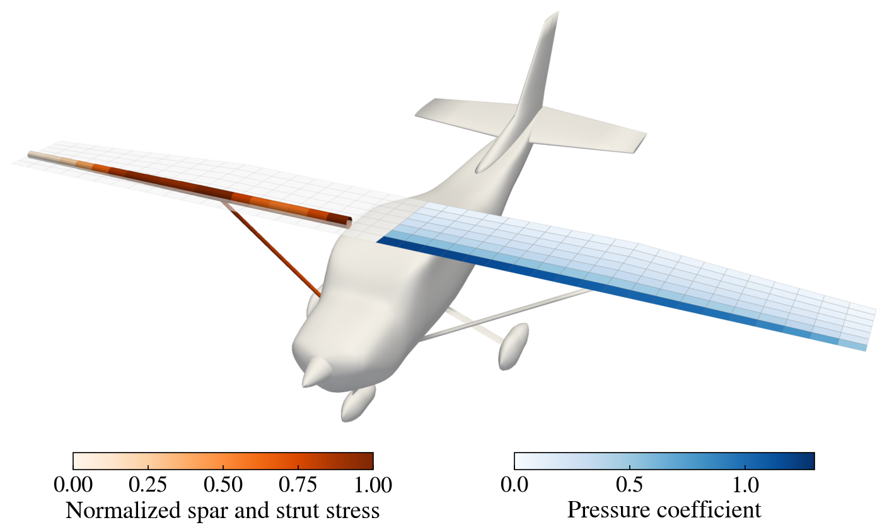

# Cessna strut-braced wing design (jframe)

The aerostructural ALBCD example of [../cessna/](../cessna/README.md), with the structure
modeled by the `jframe` package, a differentiable 3D frame solver in JAX, instead of `beam_jax.py`,
and with the Cessna 182's wing struts. The wing is the same (11 m span, constant 1.5 m chord
over the inboard half of each semispan, tapering to 1.0 m at the tip), and the problem is
the same: minimize the drag of the wing over its twist, subject to lift = weight, while
sizing the structure so that the von Mises stress under a 5 g maneuver (with a 1.5 safety
factor) stays below yield and every wall stays above a 1 mm minimum gauge. Both structural
constraints are aggregated with KS functions. The aerodynamics and the structure are the
two ALBCD blocks, coupled through copies of the aero loads and the weight.

As on the Cessna 182, each wing is braced by a strut instead of being cantilevered from the
centerline:

- Each spar is a tube along the root quarter chord from its root fitting at the side of the
  cabin (y = ±0.55 m) to the tip. The root fitting is a pin for flapwise bending: it holds the
  spar's translations, twist and chordwise bending, but not its flapwise rotation, so the
  strut carries the bending moment. The aero loads inboard of the root fittings go straight
  into the fuselage.
- Each strut is a 50 mm diameter tube from its lower-fuselage fitting (taken from
  `cessna182_no_wing.stl`), where it is pinned, to the spar at y = ±2.475 m (the VLM station
  nearest the 182's 2.6 m), where it is rigidly joined; jframe joints share all six degrees
  of freedom.
- The wall thickness of each strut is a design variable of the structures block, alongside
  the spar's thickness control points. The strut stresses and thicknesses join the KS
  constraints, and the strut mass joins the weight.

Bracing the wing cuts the optimal spar mass from 108 kg (the cantilever of `../cessna/`) to
29 kg, plus 3 kg of struts (1.8 mm walls), so the wing needs less lift and its drag
coefficient drops from 0.00547 to 0.00472. ALBCD, with the same settings as `../cessna/`,
converges in 9 outer iterations (51 sweeps) to within 0.13% of the monolithic design.

Each subproblem compiles its objective, local constraints and their derivatives once with
`jax.jit`, passing the values that change between solves as arguments, so every block solve
reuses the same compiled code.

| File | Contents |
| --- | --- |
| `cessna.py` | The ALBCD solve. Run this. |
| `monolithic.py` | The same problem solved with a single SLSQP; writes the reference solution `monolithic_solution.npz` |
| `models.py` | Wing, spar and strut setup, and the aerodynamic and structural models, shared by all the scripts |
| `problem_data.py` | Evaluates the initial and monolithic optimal designs; writes `cessna_problem.npz` |
| `fig_problem_render.py` | The problem figure `fig_problem_render.png`: the optimal wing on the airframe, with the pressure coefficient on the left semispan and the spar and strut stress on the right |
| `vlm_jax/` | Vortex-lattice aerodynamics, a JAX port of the aerodynamics in OpenAeroStruct |
| `cessna182_no_wing.stl` | Cessna 182 fuselage and struts (without wing), for the PyVista views |

jframe is a separate package; install it into the same environment first:

```bash
pip install -e path/to/jframe
```

```bash
python examples/jax/cessna_jframe/monolithic.py
```

```bash
python examples/jax/cessna_jframe/cessna.py
```

```bash
python examples/jax/cessna_jframe/problem_data.py
```

```bash
python examples/jax/cessna_jframe/fig_problem_render.py
```


