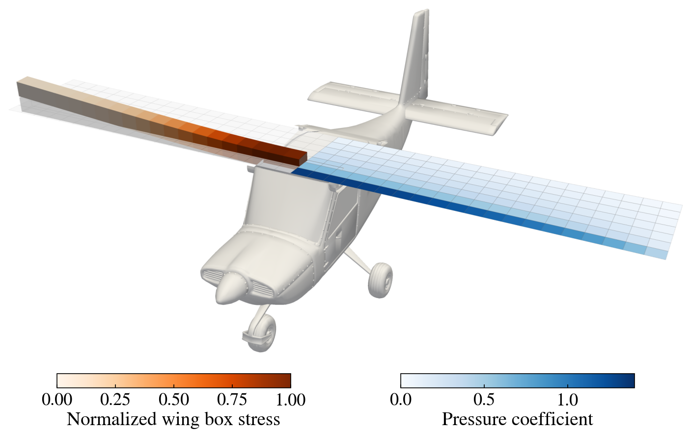

# Vashon Ranger R7 wing design

An aerostructural ALBCD example on the wing of the Vashon Ranger R7, a light sport aircraft
with a rectangular, cantilevered high wing (9 m span, 1.4 m chord). It follows
[../cessna/](../cessna/README.md) and [../cessna_jframe/](../cessna_jframe/README.md), with the
aerodynamics from the `jvlm-oas` package (`jvlm`) and the structure from the `jframe` package,
both differentiable in JAX. It minimizes the drag of the wing over its twist, subject to
lift = weight, while sizing the wing box so that the von Mises stress under a 4 g maneuver
(the ASTM F2245 limit load for light sport aircraft, with a 1.5 safety factor) stays below
yield and every wall stays above a 1 mm minimum gauge. The stress constraint is aggregated
with a KS function, and the minimum gauge is a lower bound on the thickness control points.
The aerodynamics and the structure are the two ALBCD blocks, coupled through copies of the
aero loads and the weight.

- The aerodynamics are a full-span vortex lattice of 7 x 40 panels at 50 m/s and 1.0 kg/m^3,
  twisted about the quarter chord by a 7-point B-spline.
- The wing box is a square tube, 0.16 chords (224 mm) on a side, along the quarter chord and
  clamped at the centerline. A single wall thickness applies to all four walls, the two caps
  and the two webs (`jframe.CSRectTube`). It is symmetric, an 8-point cubic B-spline
  (`jframe.BSpline`) over the semispan from the root to the tip. A spline across the whole
  span has to stay smooth through the root, but the optimal thickness peaks there with a
  corner; such a spline needs many more control points to come close, and ripples outboard.
  The spline is a convex combination of its control points, so bounding them at the minimum
  gauge keeps every wall at or above it.
- The aircraft's mass without the wing box is 550 kg, so that the gross weight is close to
  the 600 kg (1320 lb) limit for light sport aircraft. The wing box is aluminum 2024-T3.

At the monolithic optimum the wing box weighs 23.5 kg, with the stress at yield at the root
and the walls at the minimum gauge outboard of y = 1 m, and the wing flies at CL = 0.357 with
CD = 0.00616. ALBCD, with the same settings as `../cessna/`, converges in 9 outer iterations
(48 sweeps) to within 0.06% of the monolithic design and 0.05% of its drag. Since the
minimum gauge is a bound, active over most of the span, the structures block measures its
optimality with the projected gradient: on a bound, only the part of the gradient that pulls
the variable away from the bound counts.

Each subproblem compiles its objective, local constraints and their derivatives once with
`jax.jit`, passing the values that change between solves as arguments, so every block solve
reuses the same compiled code.

| File | Contents |
| --- | --- |
| `ranger.py` | The ALBCD solve. Run this. |
| `monolithic.py` | The same problem solved with a single SLSQP; writes the reference solution `monolithic_solution.npz` |
| `models.py` | Wing and wing box setup, and the aerodynamic and structural models, shared by all the scripts |
| `problem_data.py` | Evaluates the initial and monolithic optimal designs; writes `ranger_problem.npz` |
| `fig_problem_render.py` | The problem figure `fig_problem_render.png`: the optimal wing on the airframe, with the pressure coefficient on the left semispan and the wing box stress on the right, the wing box drawn deflected at the design load over a ghost of it undeflected |
| `Vashon_Ranger_R7.stl` | Ranger R7 airframe (in mm), for the PyVista views |

jvlm-oas and jframe are separate packages; install them into the same environment first:

```bash
pip install -e path/to/jvlm-oas path/to/jframe
```

```bash
python examples/jax/ranger/monolithic.py
```

```bash
python examples/jax/ranger/ranger.py
```

```bash
python examples/jax/ranger/problem_data.py
```

```bash
python examples/jax/ranger/fig_problem_render.py
```


