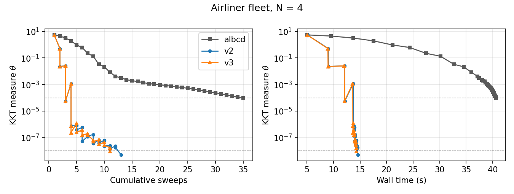
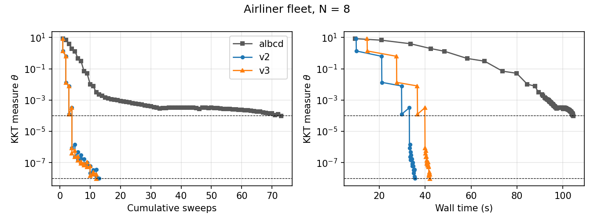
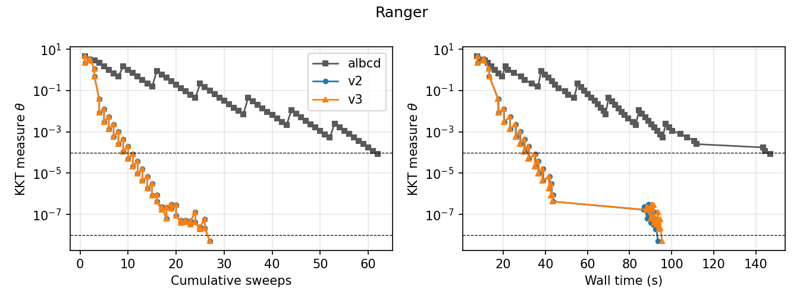

# QuasiNewtonALBCD: report

Implementation of `qn/IMPLEMENTATION_PLAN.md`. All new work is in `qn/`; no existing file was modified (see
"Repository state"). Everything was run with the `jaxenv` conda environment (Python 3.14, jax x64, modopt,
`albcd` installed editable from `src/`), `PYTHONDONTWRITEBYTECODE=1` and `pytest -p no:cacheprovider`.

## What was built

| File | Contents |
|---|---|
| `qn_subproblem.py` | `QNSubproblem(albcd.Subproblem)`: `x_scale`, `linearize()`, `local_multipliers()`, harvesting contract |
| `qn_core.py` | numpy-only core: damped BFGS + init rule, penalty update, stationarity / AL gradient, active sets, KKT measure θ, block condensation, coordinator solve, back-substitution, coupled step with refinement |
| `qn_albcd.py` | `QuasiNewtonALBCD(albcd.ALBCD)`: modes `dual` (V1), `primal_dual` (V2), `adaptive` (V3), outer and harvested pairs, acceptance test, fallbacks, μ growth, event history (§2.4) |
| `airliner_blocks.py`, `ranger_blocks.py` | copies of the examples' subproblem classes as `QNSubproblem`s, with `linearize`, `local_multipliers`, harvesting; `make_solver`, `compile_models` |
| `monolithic_tight_ranger.py`, `monolithic_tight_airliner.py` | Task 5 tight references |
| `experiments_airliner.py`, `experiments_ranger.py`, `experiments_common.py` | Task 6 runs and summary tables |
| `analyze_results.py`, `figures.py` | observations (`results/qn_observations.txt`) and figures for this report |
| `conftest.py`, `tests/` | 75 tests + 1 strict xfail: `pytest -p no:cacheprovider qn/tests` (≈6.5 min, slow ones marked `slow`) |

The solver modules (`qn_core`, `qn_subproblem`, `qn_albcd`) import only numpy and `albcd`. No second derivatives
are used anywhere in the method.

## Tight references (Task 5)

| Problem | Solver | Time | Agreement with the example's reference | Accuracy |
|---|---|---|---|---|
| Ranger | SLSQP ftol 1e-14 | 2.3 s, 28 it | CD equal to 2e-16; ‖x − x_ref‖ = 8e-10 | KKT stationarity 2.7e-9 (1e2·CD scale), feasibility 5e-12 |
| Airliner N = 4 | SLSQP ftol 1e-12 | 148 s, 149 it | fuel −4e-6 kg; cost index 0.45332414 vs 0.45332444; ‖z − z_ref‖ = 1.0e-3 (scaled) | θ = 2.0e-8 |
| Airliner N = 8 | SLSQP ftol 1e-12 | 1322 s, 187 it | fuel −4e-6 kg; cost index 0.45610933 vs 0.45610945; ‖z − z_ref‖ = 1.5e-3 | θ = 1.7e-8 |

N = 4 took less than 15 min, so N = 8 was run. The objectives match the existing references to their accuracy;
the example's airliner references (ftol 1e-9) are 1e-3 away from the tight ones in x.

## Summary tables (Task 6)

θ: final KKT measure (§1.6); ‖x−x*‖: scaled distance to the tight reference (ranger: twist and thickness only);
t / tp / sw(level): wall time, critical-path time and sweeps to the first event with θ ≤ level; total: wall time (s).
The `albcd` time (×3) is the budget of every other configuration of the same problem.

```
Airliner fleet, N = 4 (reference theta 2.00e-08, albcd time limit for the others: 122 s)
configuration  success     theta    |x-x*| sweeps solves  acc  rej  t(1e-4) tp(1e-4) sw(1e-4)  t(1e-8) tp(1e-8) sw(1e-8)   total  status
----------------------------------------------------------------------------------------------------------------------------------------
albcd             True  9.39e-05  3.22e-03     35    140    0    0     40.6     40.6       35        -        -        -    40.6  converged
albcd_tight      False  1.84e-05  3.11e-03   2620  10480    0    0     40.3     40.3       35        -        -        -   121.9  failed (time_limit)
v1               False  5.15e-05  2.48e-03    100    400    0    0     13.6     13.5        5        -        -        -    17.0  max_outer_iter (ALBCD tolerances met)
v2                True  5.04e-09  1.65e-05     13     52    8    4     12.1     12.0        3     14.6     14.2       13    14.6  kkt_tol
v3                True  9.19e-09  1.63e-05     11     44    9    3     12.1     11.9        3     14.3     13.9       11    14.3  kkt_tol
v3_mu_lo          True  8.30e-09  1.53e-05     14     56   10    6     14.3     14.1        4     15.3     14.8       14    15.3  kkt_tol
v3_mu_hi          True  6.78e-09  1.58e-05     10     40    9    6     13.4     13.2        4     14.2     13.7       10    14.2  kkt_tol
v3_outer          True  6.51e-09  3.44e-05     26    104   29   18     17.4     17.3        5     21.9     20.7       25    22.0  kkt_tol
v3_harvest       False  5.13e-08  5.10e-05     97    388    8   92     12.1     11.9        3        -        -        -    22.2  max_outer_iter
v3_norefine       True  5.25e-09  1.51e-05     17     68   13    5     11.8     11.7        3     13.2     12.6       17    13.2  kkt_tol

Airliner fleet, N = 8 (reference theta 1.66e-08, albcd time limit for the others: 313 s)
configuration  success     theta    |x-x*| sweeps solves  acc  rej  t(1e-4) tp(1e-4) sw(1e-4)  t(1e-8) tp(1e-8) sw(1e-8)   total  status
----------------------------------------------------------------------------------------------------------------------------------------
albcd             True  9.75e-05  3.43e-03     73    584    0    0    104.5    104.4       73        -        -        -   104.5  converged
v2                True  9.68e-09  2.69e-05     13    104    7    5     33.2     32.7        4     35.6     34.4       13    35.6  kkt_tol
v3                True  9.49e-09  2.61e-05     12     96    8    5     39.9     39.3        4     42.1     40.8       12    42.1  kkt_tol

Ranger (tight reference KKT stationarity 2.68e-09; albcd time limit for the others: 441 s)
configuration  success     theta    |x-x*| sweeps solves  acc  rej  t(1e-4) tp(1e-4) sw(1e-4)  t(1e-8) tp(1e-8) sw(1e-8)   total  status
----------------------------------------------------------------------------------------------------------------------------------------
albcd             True  8.44e-05  1.17e-04     62    124    0    0    146.9    143.5       62        -        -        -   147.0  converged
albcd_tight       True  7.47e-10  3.41e-08    250    500    0    0    110.7    108.3       45    188.5    180.0      155   320.3  converged
v1                True  9.06e-09  2.63e-07    133    266    0    0    133.9    130.1       61    239.8    231.3      133   239.8  kkt_tol
v2                True  5.21e-09  4.03e-08     27     54   19    7     32.2     31.5       10     93.4     91.5       27    93.4  kkt_tol
v3                True  5.21e-09  4.03e-08     27     54   19    7     31.9     31.2       10     95.4     93.2       27    95.4  kkt_tol
v3_mu_lo          True  1.03e-09  1.06e-09      9     18    6    5     24.4     23.8        8     26.5     25.7        9    26.5  kkt_tol
v3_mu_hi         False  1.32e-05  1.65e-05     98    196   96    4    132.4    127.2       72        -        -        -   209.2  max_outer_iter
v3_outer          True  6.88e-09  2.34e-08     21     42   16    6     22.8     22.2        9     36.5     35.1       21    36.5  kkt_tol
v3_harvest        True  5.37e-09  7.93e-09     31     62   27    8     46.8     45.7       14     79.9     77.4       31    79.9  kkt_tol
v3_norefine       True  5.27e-09  2.10e-08     46     92   34   16     79.9     77.7       27    101.2     97.5       46   101.2  kkt_tol
```

The critical-path time is close to the wall time on both problems: the sweeps are Gauss-Seidel (sequential), and
the QN step's parallel part (linearize + factorize, ≤ 0.1 s per block) is small next to a block solve.

## Success criteria (§4)

| Criterion | Airliner N = 4 | Airliner N = 8 | Ranger |
|---|---|---|---|
| 1. Accuracy: v2 or v3 reaches θ ≤ 1e-8, ‖x − x*‖ at the reference's level | **met** (θ 5.0e-9 / 9.2e-9, ‖x−x*‖ 1.6e-5) | **met** (θ 9.7e-9 / 9.5e-9, ‖x−x*‖ 2.6e-5) | **met** (θ 5.2e-9, ‖x−x*‖ 4.0e-8) |
| 2. Speed: v3 reaches θ ≤ 1e-4 in fewer sweeps and less wall time than albcd takes to its tolerances | **met** (3 sweeps / 12.1 s vs 35 / 40.6 s) | **met** (4 / 39.9 s vs 73 / 104.5 s) | **met** (10 / 31.9 s vs 62 / 147.0 s) |
| 3. Rate: θ_{k+1}/θ_k decreases over v3's last 5 accepted steps | **not met** | **not met** | **not met** |

Notes on criterion 1. On the airliner, the reference itself has θ = 2.0e-8 (N = 4) and 1.7e-8 (N = 8), larger than
the QN iterates' θ. At that KKT level x is only determined to ~1e-5: the six N = 4 QN runs that reached θ < 1e-8
lie 3.4e-6 – 3.4e-5 apart from *each other*, the same as their distance to the reference (1.5e-5 – 3.4e-5), and the
cost index (budget multiplier) of every one equals the reference's 0.45332414 to 1e-8. (albcd at its tolerance:
3e-3, cost index 0.453286.) On ranger, ‖x − x*‖ = 4e-8 compares with 8e-10 (unscaled) between the two
monolithic references and 3.4e-8 for `albcd_tight` at θ = 7.5e-10.

Notes on criterion 3: the step contractions θ_trial/θ_before of v3's last 5 accepted steps are

- Airliner N = 4: 0.79, 0.78, 0.47, 0.61, 0.55 (θ 1.6e-7 → 9.2e-9)
- Airliner N = 8: 0.54, 0.83, 0.51, 0.24, 0.52 (θ 1.4e-7 → 9.5e-9)
- Ranger: 0.48, 0.61, 0.32, 0.32, 0.38; successive accepted θ ratio 0.46, 0.47, 0.47, 0.52 — a clean linear rate.

What limited it:

- **Ranger: penalty-dominated block curvature (the main limit).** B_i models the block's AL Hessian
  H_i + μ Ĵ_iᵀĴ_i. In the coupled step, the block-diagonal penalty term does not cancel along the null space of the
  coupling, where the copies (loads, weight) have little or no true curvature. The step is then too short, and one
  refinement round contracts that error only by ZᵀPZ / ZᵀBZ, close to 1 when μ‖Ĵ‖² ≫ ‖H‖. The μ sweep shows this
  directly: with μ0 = 1 (`v3_mu_lo`) the last contractions are 0.23, **0.022**, 0.66, **0.052**, **0.064** —
  superlinear-looking, 9 sweeps, 26.5 s, θ = 1.0e-9; with μ0 = 10 (`v3`) a constant ≈ 0.46; with μ0 = 100
  (`v3_mu_hi`) exactly 0.470 every step, followed by sweeps that double θ again, and it fails (θ 1.3e-5 after
  100 outer iterations). The same mechanism is reproduced analytically on Task 3's copies problem (see the
  observations).
- **Airliner: the attainable accuracy floor.** The last accepted steps are all at θ = 1e-8 – 2e-7, the level where
  the tight monolithic SLSQP also stops (θ = 2e-8), and where x is only determined to ~1e-5 (above). Earlier steps
  are very strong: one step takes θ from 1.2e-3 to 7.8e-7 (N = 4) — that is where the superlinear behaviour lives.
  In addition, about half of the sweeps raise θ again (by up to 5×): SLSQP's block solves stop at a stationarity
  floor of ~5e-6 (scaled) set by ftol = 1e-9, and every sweep re-imposes that floor on the QN iterate.
- Not limited by: active-set changes (all "sign" rejections happen in the first 3 outer iterations; after the first
  acceptance there are 0–2 rejections, all "theta"), singular K (never happened; cond(K) 3e4 – 2e6 on the airliner,
  2e5 – 3e5 on ranger), μ growth (μ never grew in v2/v3 on either problem).

## Figures

θ against cumulative sweeps and against wall time for albcd, v2 and v3:

- `results/fig_theta_airliner_N4.png`
- `results/fig_theta_airliner_N8.png`
- `results/fig_theta_ranger.png`





(The wall-time gap in ranger's v2/v3 curves near θ = 4e-7, and albcd's near 125–155 s, are single sweeps in which an
OpenSQP block solve ran long from its warm start.)

## Observations

Details per configuration: `results/qn_observations.txt`.

**Acceptance rate.** Airliner: 58–75 % of the steps accepted in v2/v3 (v3: 9/12 at N = 4, 8/13 at N = 8); the
rejections are κ sign flips in the first three outer iterations, while SLSQP's active sets are still changing,
then 0–2 θ-rejections near 1e-7. Ranger: 73 % (19/26), all rejections θ-based (one of them right after a sweep in
which a block solve ran away to θ ≈ 3).

**When skipping started (V3).** Airliner: after the first accepted step, at sweep 4 (θ ≈ 8e-7), but only 1 sweep was
skipped at N = 4 and N = 8 — later steps reduce θ by less than `skip_factor` = 5. Ranger: never — no step reached a
5× reduction at μ0 = 10, so v3 and v2 are identical (same iterates, same events). With μ0 = 1, two sweeps were
skipped (from sweep 8, θ ≈ 2e-6). The skip rule therefore pays off only where steps are already fast.

**Which curvature source helped.** Outer pairs are the important source; harvested pairs help on top of them on the
airliner, and hurt slightly on ranger:

- Airliner N = 4: both 11 sweeps / 14.3 s; outer only 26 sweeps / 22.0 s; harvest only fails — it stalls at
  θ ≈ 5e-8 with 92 rejections. Mechanism of the stall: once the sweeps no longer move x (SLSQP returns after one
  iteration at its floor), no new harvested pairs arrive, B is unchanged and the same rejected step is recomputed
  every outer iteration. Outer pairs from rejected trials are what changes B in that situation.
- Ranger: outer only is the fastest configuration at μ0 = 10 (21 sweeps / 36.5 s vs 27 / 95.4 s for both): harvested pairs
  from OpenSQP's solves carry the curvature of the subproblem at the solve's (y, μ) and old values of the other
  block, which is less consistent with the coupled step than the outer pairs. Harvest only: 31 sweeps / 79.9 s.

**Refinement.** One round helps on both problems (ranger 27 vs 46 sweeps without it, airliner N = 4 11 vs 17), but it
cannot fix the penalty-dominated case: on Task 3's copies problem (μ0 = 1) the error factor per round is 109/113,
and running the refinement to convergence (refine = 100) makes things worse — H_i = B_i − Ĵ_iᵀdiag(μ)Ĵ_i is then a
small difference of two large, BFGS-estimated numbers, and every step is rejected.

**V1 (dual only).** It never moves x, so its accuracy is that of the inner loop: on the airliner θ stalls at 5e-5
(ALBCD's own tolerances met; SLSQP's floor). On ranger it reaches 9e-9, but needs 133 sweeps / 240 s — fewer sweeps
than `albcd_tight` to 1e-8 (155) but more time (189 s), and 2.5–9× slower than v2/v3.

**Plain ALBCD at tight tolerances.** On the airliner, `albcd_tight` does not get below θ ≈ 5e-6 (θ at the time limit
varies, 5e-6 – 2e-5): its inner loop asks for optimality 1e-9, below SLSQP's stationarity floor, and burns
thousands of one-iteration sweeps (2620 in the run above) until the time limit. On
ranger (OpenSQP stops on the KKT residual) it converges to θ = 7.5e-10 in 250 sweeps / 320 s (θ ≤ 1e-8 after
155 sweeps / 189 s); v3 reaches 1e-8 in 27 sweeps / 95 s, `v3_mu_lo` in 9 sweeps / 26.5 s.

**Failure modes seen.**
1. Penalty-dominated curvature → linear rate, failure at μ0 = 100 on ranger (above).
2. Harvest-only stall when the sweeps stop moving x (airliner).
3. Block solves that run away from a near-optimal warm start (ranger, OpenSQP; θ jumps to O(1) after a sweep). The
   next QN step recovers in one step because acceptance is measured against the post-sweep θ.
4. Sweeps that raise θ back to the block solver's floor (airliner, SLSQP).

**Suggestions (not implemented — the plan says not to change the method to meet a criterion).**
- Remove the block-diagonal penalty from the step instead of refining it: keep separate BFGS models of the
  Lagrangian Hessian H_i (pairs of ∇f + Jᵀλ + Jhᵀκ, without μ terms) and add the *exact* Ĵ_iᵀdiag(μ)Ĵ_i only as the
  regularizer that makes K_i invertible; then accelerate the refinement (it is a stationary iteration with a
  low-rank error operator) with a Krylov method on the m_c-dimensional coordinator system instead of a fixed number
  of rounds.
- Keep μ small once QN steps are being accepted (the step does not need the penalty for convergence; ranger μ0 = 1
  is 3.6× faster than μ0 = 10), or reduce μ after accepted steps.
- In V2/V3, skip sweeps whenever the previous step was accepted and θ is below the block solver's floor
  (the sweeps after θ ≈ 1e-6 mostly add θ back on the airliner).
- For V1, tighten the inner tolerance towards `kkt_tol` (it cannot reach 1e-8 with opt_tol = 1e-4 blocks).

## Copies of existing files

No existing files were copied. (`airliner_blocks.py` and `ranger_blocks.py` contain copies of the example scripts'
subproblem classes, as Task 4 asks; their module docstrings name the source file and lines and list every change.)

## Repository state

`git_status_before.txt` (from `git --no-optional-locks status --porcelain`) is

```
?? qn/
```

(the plan was already present; `examples/jax/ranger/monolithic_viz_2.py` was *not* modified at the start, contrary
to the plan's note — it is committed in 61475f4). `git_status_after.txt` is

```
?? examples/jax/ranger2/
?? qn/
```

**`examples/jax/ranger2/` was not created by this work.** Its files were written between 10:37 and 11:24 (a copy of
the ranger example with modified `models.py`, `monolithic.py`, `ranger.py`, `ranger_hess_init.py` and new result
files) by runs outside this session; nothing in `qn/` reads or writes it. Apart from that folder, the only change is
the new untracked `qn/` folder; no tracked file was modified and nothing was committed.

Those outside runs overlapped the first set of experiments (airliner 11:08–11:22, ranger from 11:22), so the
experiments were repeated on an idle machine (11:56–12:29; `results/cpu_watch.txt` logs one Python process —
the experiment — every 30 s). The tables above are from the repeat; the first set is kept in
`results/contended_run/`. The iterates are deterministic and identical in both sets (same sweeps, θ, ‖x − x*‖);
only the times differ (first set ~1.2–1.7× slower), except airliner `albcd_tight`, whose cut-off depends on the
time limit.

## Deviations from the plan

1. `QNSubproblem` has, besides `x_scale` / `linearize` / `local_multipliers`, two class attributes that the solver
   sets — `harvest` (record `self.curvature` only when QN uses harvested pairs, so plain ALBCD runs do not
   accumulate records) and `act_tol` (the §1.3 threshold) — and a `scale(n)` helper.
2. `qn_core.active_sets` takes an extra `tight_tol` (rows within `tight_tol` of a bound are active even with κ = 0). It
   implements §1.3's "|h| ≤ 1e-8" rule for the ranger structures block, which sets `tight_tol = 1e-8`.
3. The solver adds `lin["v"]` (the block's variables) to each linearization; `kkt_measure` and `active_sets` need it.
4. The local multipliers are stored in `QuasiNewtonALBCD.kloc`: ALBCD already uses `self.kappa` for its
   inexact-inner-loop factor.
5. `refine` accepts any integer ≥ 0 (default 1). Task 3 test 1 needs it: with B0 = the exact block AL Hessian (2 + μ)
   and refine = 1 the first step is *not* exact (an error factor μ/(2 + μ) remains). It is exact with B0 = 2 (the
   Lagrangian Hessian) and refine = 0, or with B0 = 2 + μ and refine = 60; both cases are tested. `B0` is the literal
   initial B_i and counts as initialized (no σI reset on the first pair).
6. The outer pair between the current point and a *rejected* trial is assembled with the current (λ, κ), not the
   trial's, since a rejected trial's multipliers are not used afterwards. Accepted trials use (λ_trial, κ_trial).
7. `accept <= 0` means "never accept" (otherwise θ_trial = 0 exactly would pass `θ_trial <= 0·θ`).
8. V1: the applied dual step is logged as event `dual_fallback` (the event list has no separate name). `success`
   means θ ≤ kkt_tol only; at max_outer_iter, `status` says whether ALBCD's own tolerances held.
9. The history has extra per-event keys: `cond_K` (max over blocks, recorded for every step, not only when badly
   conditioned), `reason` (`theta` / `sign` / `singular_K` for rejections), `x_event`, `y_event`, `mu_event`.
10. `AeroSubproblem.linearize` takes grad_f, J and Jh from one forward-mode Jacobian of [1e2·CD, c_aero, h]
    (9 inputs) instead of `jax.grad` + `jax.jacrev`: identical values, 0.6 s → 0.04 s per call.
11. Both examples name their model file `models.py`. The blocks import each through `sys.path` but register it under
    an alias (`airliner_fleet_models`, `ranger_models`), so both can be imported in one process (the tests do).
12. Multiplier-sign test (Task 4.3), airliner: SLSQP's ftol (1e-9) is not a stationarity tolerance; its block solves
    stop at a stationarity of ~5e-6 (scaled). The test instead requires the converted κ to be as good as
    least-squares multipliers on the same active rows (within 10×) and much better than −κ. For ranger it uses
    10 × OpenSQP's own scaled tolerance, as planned.
13. Task 3 test 5 uses μ0 = 0.1 (the plan gives no μ0). With μ0 = 1, V2/V3 converge only linearly on that problem
    (θ ≈ 1e-6 after 100 outer iterations); a strict-xfail test documents this, and it is the mechanism behind
    criterion 3 on ranger. An extra variant with the local inequality active (l + t ≤ 4) is tested as well.
14. Extra files in `qn/`: `experiments_common.py`, `analyze_results.py`, `figures.py`, logs in `results/`. The
    airliner results of both N are in one file, `results/qn_results_airliner.npz`, with keys prefixed `N4/`, `N8/`.
15. The 3×-albcd budget is enforced as a wall-time limit (a hook on the block solves raises, and the partial history
    is kept), since max_outer_iter alone does not bound the time. Only `albcd_tight` on the airliner hit it.
16. For plain ALBCD runs θ is evaluated after the run from per-sweep snapshots (iterate, y, μ, φ, κ_i) with
    λ = y + μφ, outside the timed region; ALBCD's critical-path time is its cumulative block solve time.
17. Ranger's reference accuracy is reported as the monolithic problem's KKT residual, not as θ: the monolithic
    problem has no copies, so its multipliers do not map directly onto the distributed (λ, κ). For the airliner the
    mapping is direct and θ of the reference is computed.
18. The Task 5 reference times are not from an idle machine (an exploratory QN run, and later the outside ranger2
    runs, were active), so they may be high; this does not affect the solutions. The Task 6 tables are from the
    idle-machine repeat (see "Repository state"). Wall times of identical iterate sequences vary by up to ~20 %
    between runs (e.g. ranger v3_norefine 82 s vs 101 s, airliner N = 8 v3 46 s vs 42 s); differences of that size,
    such as v2 vs v3 at N = 8, are noise.

Note on the interface: like any method with a primal step, the QN solver evaluates each block at solver-chosen
points (`linearize` at the trial point), not only through full solves.
